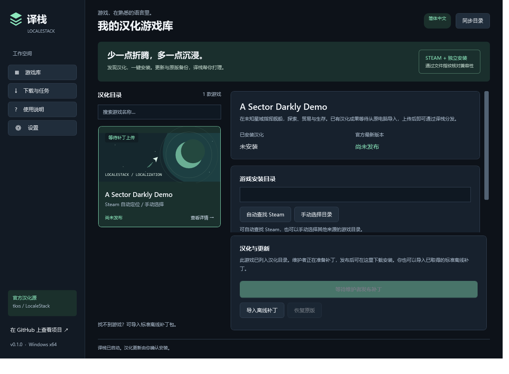

# 译栈 · LocaleStack

让好游戏，说你的语言。一个面向 Windows 的游戏汉化安装与更新管理器。

译栈将游戏目录、补丁内容与客户端分开维护：玩家选择游戏，下载安装汉化；维护者按公开格式发布补丁到 GitHub Releases，更新目录后玩家即可发现新版本。

## 下载与使用

从 [Releases](https://github.com/tkxs/LocaleStack/releases) 下载：

- `LocaleStack-Setup-win-x64.exe`：安装版，安装到当前用户目录，无需预装 .NET。
- `LocaleStack-Portable-win-x64.zip`：解压运行 `LocaleStack.exe`。
- `LocaleStack-Maintainer-win-x64.zip`：维护者命令行工具。

系统要求：Windows 10/11 64 位。首版为 `0.1.0`，支持简体中文汉化包。

1. 选择游戏，自动查找 Steam 安装位置，或手动选择游戏根目录。
2. 关闭游戏，点击下载安装；也可以导入 `.lspatch` 离线补丁。
3. 后续同步目录即可检查新版本，由玩家点击更新。需要时点击“恢复原版”。

程序未安装代码签名证书。发布文件提供 SHA-256 校验值；程序安装目录和游戏备份相互独立。

## 已实现

- 中文桌面游戏库、搜索、任务日志、下载进度与取消准备工作。
- Steam 注册表定位、多游戏库扫描、App ID / Build ID 识别。
- 非 Steam 游戏的手动目录定位；GOG、Epic、独立安装版可以分别声明兼容变体。
- 原版文件 SHA-256 指纹匹配，完整校验补丁后才进入安装阶段。
- 原版备份、重复安装、更新、恢复，以及更新时清理不再使用的补丁文件。
- 安装失败回滚；下次操作恢复上次中断的事务；未知文件修改会阻止覆盖。
- GitHub 官方目录同步、补丁更新检查、离线导入、程序新版安装包下载与校验。
- 维护者 `capture / pack / verify / inspect / catalog-add` 工具。
- 安装版、便携版和 GitHub Actions 构建发布工作流。

**通用性指的是安装协议与管理流程。** 不同游戏的文本提取、翻译、字体和版本适配仍由各游戏维护者完成。v1 安装完整文件替换型补丁；支持替换游戏资源、字体和已制作的加载器文件，不执行补丁内脚本，不支持自动翻译或任意安装钩子。

首个游戏 **A Sector Darkly Demo** 已列入目录，当前为“等待补丁上传”。原电脑的汉化内容未包含在本仓库中；没有伪造下载地址或可用状态。[导入旧补丁指南](docs/import-legacy-patch.md)

## Steam 与非 Steam 兼容

| 项目 | Steam | 其他来源 / 独立安装 |
| --- | --- | --- |
| 目录定位 | 自动扫描多个库，也可手动选择 | 手动选择 |
| 来源识别 | 检查实际安装目录对应的 appmanifest | 未关联 Steam manifest 的目录视为 standalone |
| 版本识别 | 文件指纹，可附加 Build ID 限制 | 文件指纹 |
| 补丁变体 | `storefront: steam` 或 `any` | `storefront: standalone` 或 `any` |
| 备份、校验、回滚 | 相同流程 | 相同流程 |

`any` 允许相同文件版本跨来源使用；不会跳过指纹验证。两个来源的文件不同时，应分别制作和测试变体。

## 维护一个补丁

完整操作见 [维护者指南](docs/maintainers.md)，正式协议见 [补丁格式 v1](docs/patch-format-v1.md)。

```powershell
# 使用 .NET 10 SDK，或下载维护者便携版直接运行 LocaleStack.Cli.exe
dotnet run --project src/LocaleStack.Cli -- capture --config examples/multi-store.release.json --output work/example
dotnet run --project src/LocaleStack.Cli -- pack --source work/example --output artifacts/example-1.0.0.lspatch
dotnet run --project src/LocaleStack.Cli -- verify --package artifacts/example-1.0.0.lspatch
```

先编辑示例中的游戏 ID、目录和文件列表。打包工具只读取所声明的输入文件，不会更改原版目录。

## 本地开发

需要 [.NET 10 SDK](https://dotnet.microsoft.com/download/dotnet/10.0) 和 Windows。项目运行时不依赖第三方 NuGet 包。

```powershell
dotnet build LocaleStack.sln -c Release
dotnet run --project tests/LocaleStack.Tests -c Release
dotnet run --project src/LocaleStack.App
./scripts/Build.ps1
```

安装程序使用 [Inno Setup 6](https://jrsoftware.org/isinfo.php)：

```powershell
ISCC /DAppVersion=0.1.0 packaging/LocaleStack.iss
```

发布客户端时推送 `v0.1.0` 这类稳定版本标签，Actions 会构建安装版、便携版、维护工具及校验文件。补丁 Release 使用 `patch-游戏ID-v版本号` 形式，与客户端 `v*` 标签区分。

目录结构：`src/` 客户端与核心，`catalog/` 官方游戏目录，`schemas/` JSON Schema，`games/` 游戏接入记录，`examples/` 多来源配置示例，`docs/` 协议与维护文档。

许可证：框架代码为 [MIT](LICENSE)。各游戏补丁内容的许可由维护者单独确定。


