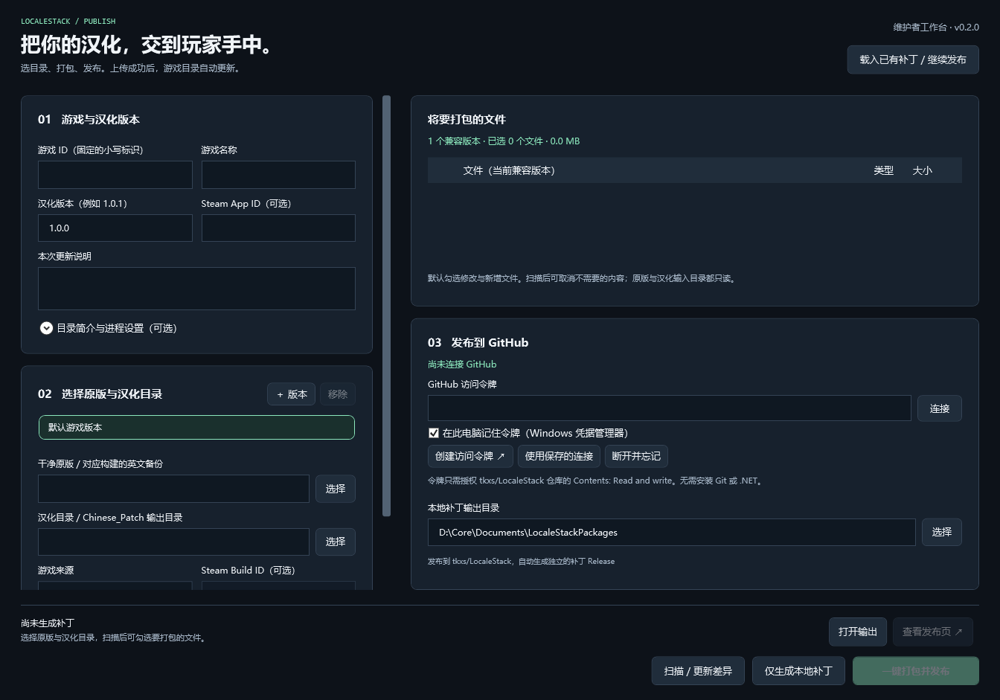

# 图形维护者工作台

从 [最新发行版](https://github.com/tkxs/LocaleStack/releases/latest) 下载 `LocaleStack-Maintainer-win-x64.zip`，解压并双击 **LocaleStack.Maintainer.exe**。也可以在完整译栈客户端侧栏点击“维护者工作台”，或从安装版的开始菜单打开它。

工具已自带运行时。不需要安装 Git、.NET SDK 或敲命令。ZIP 中的 `LocaleStack.Cli.exe` 供高级脚本使用，普通发布流程可全部在界面完成。

## 第一次连接 GitHub

1. 点击“创建访问令牌”，在浏览器里登录有 `tkxs/LocaleStack` 写入权限的 GitHub 账号。
2. 创建 fine-grained personal access token，Resource owner 选择 `tkxs`，Repository access 只选择 `LocaleStack`，Repository permissions 中将 **Contents** 设为 **Read and write**。无需授予 Workflows 权限。
3. 将生成的令牌粘贴到工作台的密码框，点击“连接”。工具会验证账号及仓库访问权限。

勾选“在此电脑记住令牌”时，令牌保存在当前 Windows 用户的凭据管理器中，不写入普通配置、日志或补丁包。下次点击“使用保存的连接”即可。换电脑后需重新连接。点击“断开并忘记”可删除本机保存的凭据。

浏览器授权和令牌创建需要由账号本人完成。令牌过期、没有 Contents 写入权限、main 分支规则禁止直接更新，或 GitHub 限流时，界面会显示错误并保留本地补丁。

## 选择目录并发布

1. 填写游戏 ID、名称、汉化版本与更新说明。游戏 ID 是固定的小写标识，例如 `a-sector-darkly-demo`，后续更新保持不变。汉化版本每次递增，例如 `1.0.0 → 1.0.1`。
2. 选择**干净原版目录**及**汉化目录**。汉化目录可以是完整游戏，也可以只有修改后的 `Chinese_Patch` 输出文件。输入目录只读。
3. 选择游戏来源：Steam、非 Steam / 独立安装，或所有来源。Steam App ID 用于玩家自动定位；Steam Build ID 可作为额外的版本限制，最终仍检查文件指纹。
4. 点击“扫描 / 更新差异”，查看修改和新增的文件。取消勾选日志、临时文件或其他不应发布的内容。工具自动跳过 `.git`、`.localestack`、`_zh_cn_backup*` 目录及位于汉化目录中的所选原版子目录。
5. 选择本地补丁输出目录。点击“仅生成本地补丁”可先在副本中测试；准备好后点击“一键打包并发布”。尚未扫描时，发布按钮会自动扫描、打包、校验，再上传。

发布过程会自动完成：

- 生成标准 `.lspatch`、原版文件指纹和包内校验值。
- 创建独立的 `patch-游戏ID-v版本` 草稿 Release。
- 上传补丁，并核对 GitHub 返回的附件 SHA-256 和大小。
- 发布补丁 Release，保持客户端的 latest 发行入口不变。
- 更新 `main` 分支的 `catalog/catalog.json`；新游戏自动添加，已有游戏自动更新版本。

无需手工创建 Release、上传附件或编辑目录。玩家同步目录后即可看到新版本。

## 多个游戏来源或构建

点击“＋ 版本”，为另一个 Steam 构建、GOG / Epic / 独立安装版分别选择原版与汉化目录。每个版本需要唯一 ID、独立目录和至少一个选中的汉化文件。右侧列表显示当前选中版本的文件，汇总显示全部版本。

被替换的原版文件自动作为识别指纹。如果补丁只新增字体等文件，工具默认用原版目录中的 exe 识别版本；没有 exe 时，请展开“版本名称与额外指纹”，选择一个原版版本资源文件。

`所有来源` 允许同一组文件跨来源使用，不会跳过哈希验证。不同来源的文件不一样时，应分别制作并测试版本。

## 失败后继续发布

网络中断、上传失败或目录写入失败时，保留已生成的 `.lspatch`。同一次会话中可直接再次点击发布；关闭工作台后，点击“载入已有补丁 / 继续发布”选中原包，再连接 GitHub。

工具会复用相同内容的远程附件，不会再次上传或覆盖同版本的不同内容。如果上传已完成但目录更新失败，重试会继续更新目录。目录同时被其他人修改时，会重新读取并合并，保留其他游戏条目；同一游戏已出现更新版本时停止。

如果 GitHub 中存在同名但内容不同的草稿附件，工具会停止，不会自动删除它。可点击“查看发布页”在 GitHub 界面处理草稿，或使用新的汉化版本号。

每个游戏的翻译、字体与运行验证仍需维护者完成。图形工具负责打包和分发，不会自动修正旧汉化内容。
